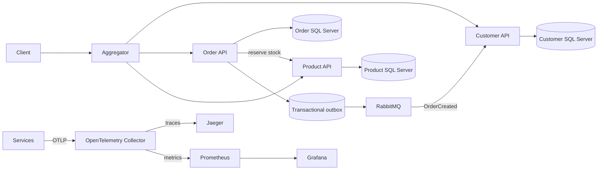

# EShop Microservices

Учебный backend интернет-магазина на ASP.NET Core и EF Core. Проект состоит из сервисов клиентов, заказов и товаров и HTTP-агрегатора, который собирает товары по заказам клиента.

## Архитектура



Каждый сервис владеет собственной базой. Aggregator запрашивает клиента по имени, его заказы и товары для этих заказов. Запросы товаров выполняются параллельно. Для CRUD сервисы используют EF Core; базы обновляются при старте через migrations. Демонстрационные данные по умолчанию создаются только в Development; Compose явно включает их для воспроизводимого локального примера. Перед обновлением существующей базы создайте резервную копию и проверьте историю миграций.

## Запуск через Docker

Требуются Docker и Docker Compose. Для трёх экземпляров SQL Server рекомендуется не менее 8 ГБ оперативной памяти.

1. Скопируйте `.env.example` в `.env` и замените `DB_PASSWORD`, три отдельных app `*_DB_PASSWORD`, три `*_MIGRATOR_DB_PASSWORD`, `RABBITMQ_PASSWORD`, `JWT_SIGNING_KEY`, `SERVICE_AUTH_KEY` и `GRAFANA_ADMIN_PASSWORD` независимыми секретами. JWT и service keys должны содержать минимум 32 байта.
2. Выполните `docker compose up --build -d`.
3. Проверьте состояние командой `docker compose ps` и откройте Swagger.

| Сервис | Swagger | Health |
| --- | --- | --- |
| Aggregator | http://localhost:5000/swagger | `/health/live`, `/health/ready` |
| Customer | http://localhost:5001/swagger | `/health/live`, `/health/ready` |
| Order | http://localhost:5002/swagger | `/health/live`, `/health/ready` |
| Product | http://localhost:5003/swagger | `/health/live`, `/health/ready` |
| Prometheus | http://localhost:9090 | metrics storage/query |
| Grafana | http://localhost:3000 | preconfigured EShop dashboard |

SQL Server использует порты 1433, 1434 и 1435. Docker volumes сохраняют данные между запусками. При смене пароля существующие базы сохраняют прежний пароль; для учебного окружения можно удалить данные командой `docker compose down -v`, которая безвозвратно удаляет эти volumes.

Сервисы отправляют traces и metrics по OTLP в OpenTelemetry Collector. Collector передаёт traces в Jaeger (UI: http://localhost:16686) и отдаёт metrics Prometheus; Grafana (http://localhost:3000, локальные credentials по умолчанию `admin`/`admin`) автоматически подключает datasource и dashboard EShop. Задайте `GF_SECURITY_ADMIN_PASSWORD` перед любым совместным или внешним запуском. Prometheus хранит metrics в Docker volume семь дней. RabbitMQ management доступен на http://localhost:15672; учётные данные задаются через `RABBITMQ_PASSWORD` в `.env`.

Пример агрегирующего запроса: `GET http://localhost:5000/api/v1/Shop/Customers/Guest`. CRUD endpoints и их схемы доступны в Swagger соответствующего сервиса. `/health/live` проверяет процесс; `/health/ready` у микросервисов проверяет базу данных, а у Gateway — готовность Customer, Order и Product.

Примеры готовых HTTP-запросов для REST Client в VS Code/Visual Studio находятся в [`docs/demo.http`](docs/demo.http). Сценарий короткой презентации описан в [`docs/demo-walkthrough.md`](docs/demo-walkthrough.md). Для защищённых операций укажите JWT от доверенного issuer; Swagger показывает Bearer для защищённых действий и `X-Service-Key` для внутренних reserve/release операций товара.

Коллекции принимают `page` и `pageSize` (по умолчанию 1 и 20, максимум 100), а также `sortBy` и `descending`. Допустимые поля: Customer — `id`, `name`, `city`; Product — `id`, `name`, `rate`; Order — `id`, `date`, `status`. Каталог поддерживает индексированный префиксный фильтр `name` и диапазон `minRate`/`maxRate`. Order-сервис резервирует доступный остаток через Product API и записывает `OrderCreated` в outbox в транзакции с заказом; Customer-сервис обновляет проекцию заказов через RabbitMQ с дедупликацией по ID события.

Записи клиентов и заказов требуют JWT с `iss=eshop`, `aud=eshop-api`; создание заказа требует claim `customer_id`, совпадающий с CustomerId. Изменение каталога требует роль `Admin`. Product API резервирует остаток только по внутреннему `X-Service-Key`. Этот репозиторий не выпускает JWT: для запуска защищённых операций нужен токен от доверенного issuer, подписанный `JWT_SIGNING_KEY`.

## Сборка и тесты

Установите .NET SDK 10.0, затем выполните:

```bash
dotnet restore Microservice.WebApi.sln -m:1
dotnet tool restore
dotnet build Microservice.WebApi.sln -c Release --no-restore -m:1
dotnet test Integration.Tests/Integration.Tests.csproj -c Release --collect:"XPlat Code Coverage" --results-directory TestResults
```

Сорок два SQLite/HTTP теста проверяют защищённые маршруты, JWT-подписи и роли, HTTP CRUD для Product, Customer и Order, валидацию запросов и владение ресурсами, service-key inventory API и реальный HTTP-вызов Order → Product с отказом при недостатке товара и освобождением резерва при отмене заказа; Problem Details во всех приложениях, readiness сервисов, W3C traceparent, retry временного 503, timeout зависшего downstream, circuit breaker и concurrency limiter, задержку/отмену запросов и агрегацию. SQLite проверяет идемпотентность inventory reservation и Customer order projection, доступность БД для health checks, фильтры/сортировку, пагинацию, сохранение заказа с outbox, компенсацию отмены и recovery зависшего reservation intent. Также проверяется создание контекста без внешней БД. Отдельный тест применяет миграции всех трёх сервисов к SQL Server в CI; локально он пропускается, если не задана `ESHOP_SQLSERVER_ADMIN_CONNECTION`. Текущий локальный отчёт Coverlet: 25,42% line coverage и 35,63% branch coverage; CI блокирует регрессии ниже 20% line и 30% branch coverage. NuGet Audit warnings NU1901–NU1904 считаются ошибками.

## Ограничения

Проект предназначен для демонстрации и требует дополнительной подготовки перед production-развёртыванием. JWT-проверка, проверки ролей и владения ресурсами реализованы, но сам issuer и выпуск токенов в репозиторий не входят. Между резервированием товара и созданием заказа нет распределённой транзакции: Order сохраняет reservation intent до вызова Product, использует повторяемый reservation ID и stale-intent recovery worker для освобождения неопределённых резервов. Резерв Product обновляется идемпотентно; crash recovery нужно отдельно проверить на SQL Server. Outbox доставляет события как минимум один раз, поэтому потребители должны сохранять идемпотентность.

Сервисы применяют EF Core migrations при старте через отдельный migration login; migration credentials используются только на время миграции и восстановления контекста к runtime connection string. Runtime login каждого сервиса имеет доступ только к своей базе и роли чтения/записи, без `db_ddladmin`; право DDL есть только у migration login. CI проверяет, что модели соответствуют последним миграциям. Перед подключением существующей базы нужно проверить её историю и схему миграций и сделать резервную копию. Readiness микросервисов проверяет БД, Gateway — готовность downstream, Compose probes настроены, но не проверены запуском контейнеров в этой среде. SQL Server работает в редакции Developer; перед внешним production-развёртыванием следует сменить редакцию СУБД и проверить отказоустойчивость SQL Server/RabbitMQ.
